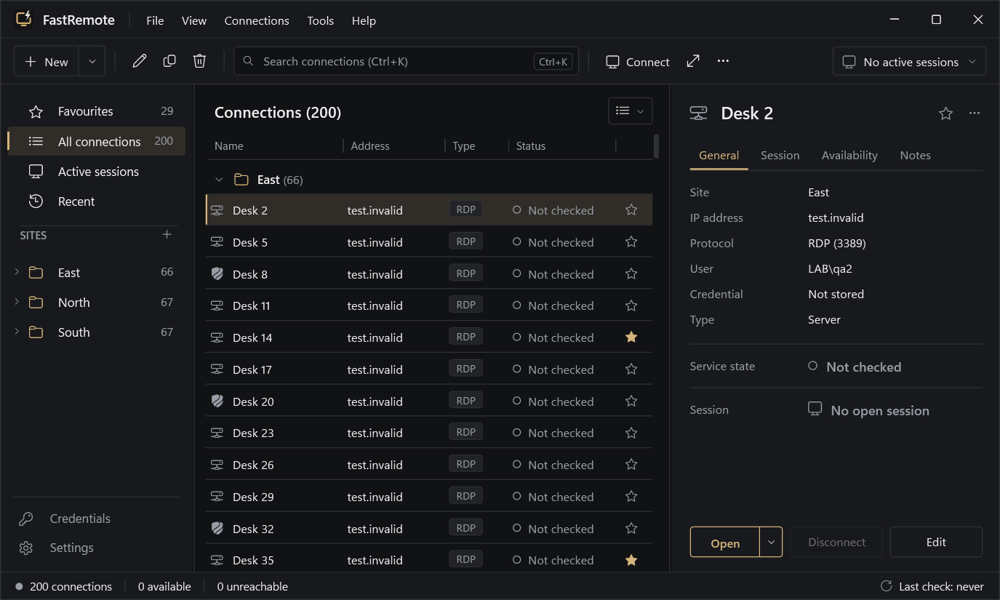

<div align="center">


# F A S T R E M O T E

RDP launcher for Windows. Every connection in its own mstsc

  

<a href="https://github.com/4leX-42/FastRemote/releases/latest/download/FastRemote.exe"><b>DOWNLOAD FOR WINDOWS →</b></a>



</div>

For IT support that jumps between many Windows servers across sites. FastRemote keeps your RDP connections
organised by site, shows which servers answer before you click, and tells you which sessions are open and in
what state. Each connection opens in the native Remote Desktop client (`mstsc`): no embedded tabs, no agent on
the servers, nothing to install.

| | |
|---|---|
|  **Sites** | Servers grouped by site · drag to reorder · favourites, recent |
|  **Status** | RDP port of every server on start → every 5 min, one at a time |
|  **Sessions** | Connecting → connected → interrupted, read from the real mstsc windows · tabs with duration |
|  **Search** | `Ctrl+K` name, host, user, tags · `Ctrl+Shift+P` commands |
|  **Credentials** | Windows Credential Manager (`TERMSRV/<host>`) · own, shared with other servers, or none |
|  **Import** | mRemoteNG `confCons.xml` → connections, folders, passwords |

<p align="center"><sub>single .exe · no install · no telemetry · EN/ES</sub></p>

<details>
<summary> <b>Keyboard</b></summary>

| | |
|---|---|
| `Enter` · `Ctrl+Enter` · `Shift+Enter` | connect · admin session (`/admin`) · full screen |
| `Ctrl+K` · `Ctrl+Shift+P` · `F5` | search · commands · check all |
| `Ctrl+N` · `F2` · `Del` · `Ctrl+D` | new · edit · delete · duplicate |
</details>

<details>
<summary> <b>Under the hood</b></summary>

- Data in `%APPDATA%\FastRemote` · `.rdp` files (no password inside) in `%LOCALAPPDATA%\FastRemote\rdp`, cleaned on start.
- Status = one TCP connection to the RDP port, no credentials. Turn it off in *Settings → Availability* if your EDR flags it.
- Saved credentials refused outside the domain → policy *Allow delegating saved credentials with NTLM-only server authentication* for `TERMSRV/*`.

```powershell
.\build.ps1                                     # dist\FastRemote.exe
dotnet test tests\FastRemote.Tests              # unit, scenarios, rendering 100-200 %
powershell -File tests\Test-FastRemoteUi.ps1    # UI Automation, isolated instance
```
</details>

<sub>MIT licence · not affiliated with mRemoteNG or Microsoft</sub>
